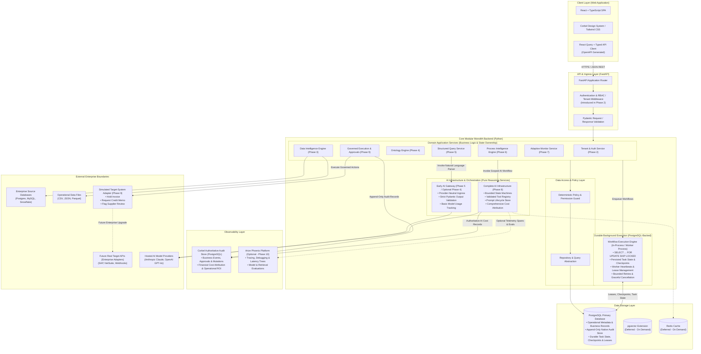
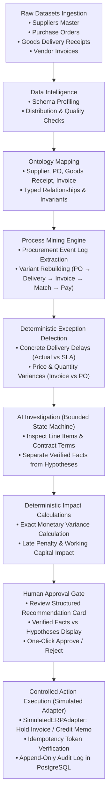

# Corbel — System Architecture

> [!IMPORTANT]
> **Target Architecture vs. Phased Implementation Scope:**
> This document describes the **target system architecture** for the Corbel platform. It does **not** authorize implementing every capability, domain, or layer during Phase 1. Implementation must strictly adhere to the authoritative phased roadmap in `docs/IMPLEMENTATION_PLAN.md`. Phase 1 remains strictly limited to the application foundation (repository structure, FastAPI backend foundation, React + TypeScript frontend foundation, PostgreSQL connectivity, Alembic migrations, environment configuration, health check endpoints, structured logging, foundation tests, and dual local development modes). Capabilities such as authentication, tenant isolation, ontology discovery, process mining, AI agents, prompt management, Redis, Arize Phoenix, durable task execution, and governed business actions are introduced incrementally in their designated roadmap phases.

---

## 1. Architectural Strategy: The Modular Monolith

Corbel is architected as a **Modular Monolith**. 

Distributed microservices introduce significant early-stage operational friction: distributed transaction complexity, network serialization overhead, brittle API contract versioning, synchronization lag, and complex local debugging environments. For an enterprise operational intelligence platform where cross-domain data consistency (e.g., matching a Process Event to an Ontology Business Object and linking to a Finding, Investigation, Approval, and Action) is paramount, a well-structured modular monolith provides:

1. **Strict Logical Boundaries Without Inter-Service Network Latency:** Core domain services communicate via clean, typed in-process Python interfaces, eliminating internal network hops, serialization overhead, and RPC failure modes during synchronous cross-domain operations.
2. **Transactional Consistency:** Relational integrity, foreign key constraints, and ACID transactions are guaranteed by PostgreSQL across operational entities.
3. **Single-Process Observability & Developer Ergonomics:** The complete backend can run natively on the host or inside a container, accelerating automated testing, local development, and end-to-end debugging.
4. **Pragmatic Service Extraction Path:** Because modules are organized into decoupled domain packages with isolated data models and explicit interfaces, any bottlenecked module can be extracted into an independent service in the future. Any future service extraction requires establishing explicit, decoupled database schema ownership (moving away from shared tables) and formal, versioned network API contracts (e.g., REST or gRPC with backwards-compatibility guarantees), rather than simply migrating Python source code.

---

## 2. High-Level System Architecture



---

## 3. Domain Boundaries and AI Infrastructure Interaction Model

A critical architectural invariant in Corbel is the strict separation between **Domain Application Services** and **AI Infrastructure**:

```
+---------------------------------------------------------------------------------+
|                       ONE-DIRECTIONAL INTERACTION MODEL                         |
+---------------------------------------------------------------------------------+
|                                                                                 |
|  [ Domain Application Service ] (e.g. InvestigationService, MonitorService)     |
|          │                                                                      |
|          │ 1. Determines that analytical reasoning or AI synthesis is required   |
|          │ 2. Invokes approved AI workflow via explicit interface                |
|          ▼                                                                      |
|  [ AI Workflow (Bounded State Machine) ] (AI Infrastructure Layer)             |
|          │                                                                      |
|          │ 3. Receives scoped context and restricted set of permitted tools     |
|          │ 4. Executes bounded reasoning loop (strictly read-only tools)        |
|          │ 5. Returns structured, Pydantic-validated output schema              |
|          ▼                                                                      |
|  [ Domain Application Service ]                                                 |
|          │                                                                      |
|          │ 6. Validates result against business domain rules and invariants     |
|          │ 7. Persists findings, recommendations, or candidate actions          |
|          │ 8. Consequential actions gated by deterministic policy & human signoff|
|          ▼                                                                      |
|  [ Deterministic Execution Engine ]                                             |
|                                                                                 |
+---------------------------------------------------------------------------------+
```

### Prohibitions on AI Infrastructure
To guarantee deterministic governance, the AI Infrastructure and its execution models must **never**:
1. **Own business domain logic:** Business entities, state invariants, and operational workflows belong exclusively to Domain Application Services (`src/corbel/domains/`).
2. **Bypass domain application services:** External requests cannot invoke the AI gateway directly without passing through domain service orchestration.
3. **Directly control domain persistence:** AI workflows cannot execute database transactions or write directly to domain entities; they return validated data structures to domain services.
4. **Grant permissions or modify tool allowlists:** Permitted tools, token budgets, and step limits are fixed by the calling domain service.
5. **Execute unauthorized mutations:** Consequential actions require explicit backend policy authorization and authenticated human approval.

---

## 4. Phased AI Infrastructure & Economics

To maintain clean architectural dependencies, Corbel distinguishes between **Early AI Capability** and **Complete AI Infrastructure**:

### 4.1. Early AI Capability (Phase 5 / Optional Phase 4)
When structured natural language querying is introduced in Phase 5 (or if semantic candidate inference is enabled in Phase 4), it requires only a focused, lightweight AI gateway:
- **Provider-Neutral Model Ingress:** A clean Python interface routing prompts to hosted providers (e.g., Anthropic Claude, OpenAI). Application code does not call vendor SDKs directly.
- **Strict Pydantic Output Validation:** LLM responses are parsed directly into validated Pydantic models (e.g., query ASTs, entity candidate mappings). Malformed outputs are rejected before query execution.
- **Basic Model Usage Tracking:** Captures raw prompt/completion token counts, provider name, and request latency per query invocation, without complex multi-tenant budget attribution.
- **No Premature Agent Complexity:** Avoids general-purpose multi-agent harnesses, autonomous loops, or complex tool registries until full process investigations require them.

### 4.2. Complete AI Infrastructure (Phase 8)
Full operational investigations and multi-step reasoning are introduced in Phase 8, delivering the complete AI systems engineering suite:
- **Bounded, Task-Specific State Machines:** Replaces unconstrained agent loops with deterministic, finite state machines tailored to specific operational tasks (see Section 5).
- **Validated Tool Registry:** Typed Python functions with Pydantic schemas, strict read-only execution constraints, and pre-execution parameter verification.
- **Prompt Management & Lifecycle Store:** Versioned prompt definitions with complete lifecycle governance.
- **Comprehensive Cost & Token Attribution:** Granular multi-tenant, project, use-case, workflow, and agent cost accounting, dollar cost estimation, cached token accounting, task outcome correlation, and cost per successful task reporting.
- **Multi-Level Caching Architecture:** Tiered caching strategies optimizing latency and cost without compromising governance.
- **Evaluation & Regression Framework:** Automated benchmarks measuring grounding, tool selection, and schema compliance.

---

## 5. Agent Architecture: Task-Specific Bounded State Machines

Corbel explicitly rejects unconstrained, generic ReAct loops for core operational workflows. Enterprise operations demand predictable, auditable, and bounded execution paths. Workflows are modeled as **task-specific finite state machines**:

### 5.1. Workflow State Machine Examples

```
[ Data Discovery Workflow ]
Inspect Schema ──> Profile Distribution ──> Infer Entities ──> Validate Invariants ──> Correct (Human Review) ──> Save Model

[ Process Investigation Workflow ]
Detect Finding ──> Retrieve Event Context ──> Correlate Objects ──> Investigate Causes ──> Verify Facts ──> Explain Hypothesis

[ Rule Generation Workflow ]
Observe Exceptions ──> Identify Pattern ──> Propose Rule ──> Test against History ──> Validate ──> Human Approve ──> Activate
```

### 5.2. AI Reasoning vs. Deterministic State Machine Control
Within Corbel, the AI reasoning engine does not control the execution harness; rather, the deterministic state machine controls the AI:
- **LLM Step Selection:** Within any active analytical state (e.g., `Investigate Causes`), the LLM may dynamically reason over context and select which permitted read-only investigative tool or sub-query to invoke from an explicitly whitelisted set.
- **Deterministic State Machine Enforcement:** The backend state machine deterministically governs the workflow by:
  - Dictating legal state transitions and workflow progression.
  - Enforcing strict tool parameter validation via Pydantic schemas.
  - Scoping tool permissions strictly to read-only queries during investigation.
  - Decrementing token and dollar budgets on every invocation.
  - Tracking step counts against configured limits.
  - Executing termination conditions or triggering escalation to human operators when confidence thresholds are not met.
  - Preventing the model from granting itself permissions or directly triggering mutations.

### 5.3. Mandatory Workflow Guardrails
Every AI workflow execution must adhere to strict bounds enforced in deterministic Python code:
1. **Maximum Iterations:** Hard execution step caps (e.g., 5-8 steps maximum per investigation).
2. **Token & Cost Budgets:** Explicit upper bounds on cumulative tokens and dollar expenditure per execution.
3. **Configurable Workflow Timeouts:** Timeouts are configured per workflow category rather than imposing a single universal limit. Interactive operations (e.g., query compilation) enforce tight timeouts (e.g., 10–30 seconds), while long-running background workflows (e.g., batch dataset profiling, process event reconstruction, multi-step investigations) utilize configurable timeouts (e.g., 5–30 minutes) governed by heartbeats and persisted checkpoints to prevent zombie executions.
4. **Scoped Tool Permissions:** Tools are explicitly whitelisted per state machine; investigation workflows receive strictly read-only analytical tools.
5. **Durable Checkpointing & State Persistence:** Execution state is saved at intermediate transitions in PostgreSQL to enable auditing, crash recovery, and resume-on-failure.
6. **Deterministic Failure Policies:** Graceful error handling with escalation to human operators when confidence scores fall below threshold.
7. **Zero Self-Granted Authorization:** An AI agent cannot modify its own permissions, alter tool schemas, or trigger external state mutations. Consequential actions require explicit backend authorization and human approval.

---

## 6. PostgreSQL-Backed Durable Background Execution

Operational intelligence workloads—such as batch dataset profiling, process event log extraction, continuous monitor sweeps, and multi-step investigations—are inherently long-running. They must not run as fragile, unpersisted in-memory background threads.

Corbel implements **PostgreSQL-backed durable background execution** maintained within the modular monolith and same Python codebase (running in-process or as a dedicated worker process, without introducing external microservices):

### 6.1. Core Execution Mechanics
- **Safe Concurrent Job Claiming:** Workers claim jobs using PostgreSQL transactions and `SELECT ... FOR UPDATE SKIP LOCKED`, preventing race conditions and duplicate claims across concurrent workers.
- **Worker Leases & Heartbeats:** Active workers claim jobs with a time-bounded lease and emit regular heartbeats. If a worker crashes or becomes unresponsive, its lease expires, allowing another worker to safely re-claim the task.
- **Checkpointing & Resumption:** Long-running workflows persist intermediate state and step checkpoints. When an interrupted job is recovered, it resumes from its last successfully persisted checkpoint rather than restarting from the beginning.
- **Idempotency Keys:** Every task execution and action dispatch carries an idempotency key persisted in PostgreSQL.
- **Bounded Retries with Backoff:** Transient failures (e.g., database connection blips, transient rate limits) trigger deterministic exponential backoff retries. Permanent failures (e.g., schema validation errors, constraint violations) fail immediately without retrying.
- **Explicit Terminal States:** Tasks transition through explicit states: `PENDING` → `RUNNING` → `COMPLETED`, `FAILED` (terminal failure/dead-letter), or `CANCELLED`.
- **Realism Regarding External API Calls:** PostgreSQL transactions do **not** guarantee exactly-once execution of external network or API calls. External operations must rely on target-system idempotency support where available, combined with status reconciliation and compensating actions where necessary.

### 6.2. Workflow Cancellation and Graceful Worker Shutdown
- **Cancellation Requests:** Users or governing policies can submit cancellation requests against running tasks.
- **Boundary Checks:** Workers check for cancellation requests at safe execution boundaries (between state machine transitions or task checkpoints).
- **Graceful Termination:** Upon detecting a cancellation request, the workflow stops cleanly without corrupting persisted state, transitions the task to `CANCELLED`, safely releases worker leases and resources, and preserves completed intermediate work and audit trails.
- **Graceful Worker Shutdown:** When a worker process receives termination signals (`SIGTERM`, `SIGINT`), it stops accepting new jobs, permits active jobs to complete their current checkpoint, releases active leases cleanly, and shuts down. Unfinished tasks are **never** silently marked as completed.
- **No Premature Brokers:** Redis, Celery, Kafka, and RabbitMQ remain explicitly deferred. PostgreSQL provides robust transactional reliability and sufficient throughput for early and mid-stage enterprise workloads without secondary message broker infrastructure.

---

## 7. AI Economics & Governance

### 7.1. Prompt Management & Lifecycle Governance
Prompt templates are treated as version-controlled enterprise assets:
- **Prompt Identification:** Globally unique `prompt_id` paired with immutable semantic version tags (`major.minor.patch`).
- **Metadata Association:** Explicit tracking of prompt ownership, target workflow, model compatibility (e.g., Claude 3.5 Sonnet, GPT-4o), and expected input/output Pydantic schemas.
- **Token Budgets:** Maximum allowable input and output token budgets assigned per template.
- **Lifecycle States:**
  ```
  [ DRAFT ] ──> [ TEST ] ──> [ EVALUATE ] ──> [ APPROVE ] ──> [ DEPLOY ] ──> [ MONITOR ] ──> [ RETIRE ]
      ↑                                                                                         │
      └──────────────────────────── Rollback / Re-draft ────────────────────────────────────────┘
  ```
- **Instant Rollback:** Immediate restoration to previous approved prompt versions in production if regressions are detected.

### 7.2. Granular Cost & Token Attribution (Phase 8)
To answer the enterprise question *"What is the business value generated per dollar of AI spend?"*, Corbel attributes every model invocation along granular dimensions:
- **Attribution Dimensions:** Organization/Tenant, Project, Use Case (e.g., Procure-to-Pay), Workflow Name, Agent/State Machine, Model & Provider, Execution ID, and Prompt Version.
- **Resource Metrics:** Input tokens, output tokens, cached input tokens, execution latency (ms), cache hit/miss status, estimated/actual cost in USD.
- **Outcome Metrics:** Task outcome (`SUCCESS`, `FAILURE`, `ESCALATED`, Rejected by Human) enabling **Cost per Successful Task** calculations and multi-dimensional cost breakdowns.

### 7.3. Multi-Level Caching Architecture
Corbel defines three distinct caching tiers, keeping external cache infrastructure strictly optional and deferred until justified:

```
[ Level 1: Provider-Native Prompt Caching ]  (Leveraged where supported and beneficial)
  • Utilizes provider-level prefix caching (e.g., Anthropic Prompt Caching, OpenAI Prompt Caching).
  • Applied when static system prompts, tool definitions, or ontology schemas make it economically beneficial.
  • Zero additional infrastructure required.

[ Level 2: Exact-Response Caching (Redis) ]  (Optional / Deferred)
  • Caches deterministic responses for identical prompts, schemas, and parameter hashes.
  • Deferred until high-volume identical queries warrant external cache infrastructure.

[ Level 3: Semantic Caching (Redis) ]        (Optional / Deferred)
  • Caches conceptually similar analytical queries only where a measured use case justifies it.
  • Deferred to later phases; subject to strict governance constraints.
```

#### Semantic Caching Governance Invariants
- **Tenant Isolation:** Cache keys must strictly incorporate `tenant_id` and `project_id`. Cross-tenant cache hits are structurally impossible.
- **Authorization Scoping:** Cached results must never bypass user permission checks or role-based access filters.
- **Versioned Cache Keys & Invalidation Policies:** Cache keys incorporate version hashes of underlying schemas, business rules, prompt versions, and policy revisions. Cache entries enforce explicit TTL and freshness policies, combined with event-driven invalidation hooks on dataset mutations, avoiding reliance on unrealistic guarantees of instantaneous global cache invalidation.
- **No Caching for Consequential Decisions:** Cached responses may never be used to authorize actions, verify financial amounts, or evaluate human approval requests.

---

## 8. Authoritative Audit Log Integrity & AI Observability

### 8.1. Corbel Authoritative Audit Log Integrity (PostgreSQL)
Corbel maintains its own authoritative business audit log in PostgreSQL. Recognizing that relational database tables are not inherently immutable, Corbel enforces immutability through architectural and operational controls:
- **Append-Only Records:** The audit schema is strictly insert-only. No operational code paths or application services expose update or delete methods for audit records.
- **Database Privilege Restrictions:** The operational database role used by the application backend is granted `INSERT` and `SELECT` privileges on audit tables, while `UPDATE`, `DELETE`, `TRUNCATE`, and `DROP` privileges are explicitly revoked at the PostgreSQL database level.
- **Comprehensive Coverage:** Audit records capture all administrative modifications, policy changes, monitor evaluations, human approvals, and consequential action executions.
- **Contextual Attributes:** Every audit event records the actor (human user ID or system service), action type, timestamp, affected entity ID, tenant/project context, input payload, and execution outcome.
- **Future Archival Enhancements:** External archival (e.g., periodic exports to write-once cloud storage) or tamper-evident cryptographic verification (hash chains) may be evaluated in future hardening phases without adding unnecessary blockchain or cryptographic complexity today.

### 8.2. AI Observability: Arize Phoenix Platform (Phase 10 — Optional)
In Phase 10, **Arize Phoenix** is supported as an **optional, complementary AI observability, debugging, and evaluation platform**. It does not replace Corbel's authoritative business intelligence:

| Dimension | Corbel Native Audit Store (Authoritative Core) | Arize Phoenix Platform (Optional Integration) |
| :--- | :--- | :--- |
| **Primary Domain** | Enterprise Business Operations & Governance | AI Tracing, Model Debugging & Evaluations |
| **Storage & Store** | PostgreSQL (ACID compliant) | Phoenix Tracing Engine / OpenTelemetry Sink |
| **Authoritative Ownership** | **Authoritative source of record** for business audit events, approval trails, operational findings, and financial cost attribution. | **Observability platform** for LLM execution spans, trace trees, prompt debugging, tool execution latency, and automated model evaluations. |
| **Tracked Entities** | Business process events, findings, investigations, recommendations, human approvals, action executions, ROI metrics. | LLM invocation spans, prompt/response pairs, latency distributions, token counts, embeddings. |
| **Cost & Economics** | Business-level cost attribution by tenant, project, workflow, and cost per successful task. | Model-level inference latency, token velocity, and low-level provider telemetry. |
| **Lifecycle & Status** | Core platform dependency (always active). | Optional platform. Corbel maintains full operational and business audit functionality independently when Phoenix is offline, uninstalled, or disabled. |

*Note: Arize Phoenix is not required in the initial local development environment.*

---

## 9. Model Provider Strategy: Hosted Inference First

- **Hosted AI Inference:** Initial deployment utilizes enterprise hosted APIs (e.g., Anthropic Claude, OpenAI GPT-4o).
- **Provider-Neutral Gateway:** Application code calls an abstract gateway interface, ensuring future models or local inference instances can be attached without domain changes.
- **Local Inference Deferred:** Local model fallback (e.g., Ollama/vLLM) is an optional future capability that can be plugged in without refactoring domain logic, not an initial Phase 8 acceptance criterion.

---

## 10. Local Development Architecture

Corbel provides two distinct local development modes to accommodate developer velocity and integration rigor:

```
[ MODE 1: Default Lightweight Development Mode ] (Standard Daily Workflow)
  ┌─────────────────┐       ┌───────────────────────┐       ┌────────────────────────┐
  │   PostgreSQL    │       │     FastAPI Backend   │       │     React / Vite UI    │
  │ (Docker Container)      │ (Native Windows Host) │       │ (Native Windows Host)  │
  │   localhost:5432│       │     localhost:8000    │       │     localhost:5173     │
  └────────┬────────┘       └───────────┬───────────┘       └───────────┬────────────┘
           │                            │                               │
           └────────────────────────────┴───────────────────────────────┘
                     Configured via .env (Hot Reload / Fast Debugging)

[ MODE 2: Full Containerized Integration Mode ] (CI / Pre-Merge Verification)
  ┌──────────────────────────────────────────────────────────────────────────┐
  │                      Docker Compose Local Network                        │
  │  ┌──────────────────┐    ┌───────────────────┐    ┌───────────────────┐  │
  │  │   corbel-db      │    │  corbel-backend   │    │  corbel-frontend  │  │
  │  │  (PostgreSQL)    │    │ (FastAPI / Python)│    │   (Vite / React)  │  │
  │  └──────────────────┘    └───────────────────┘    └───────────────────┘  │
  └──────────────────────────────────────────────────────────────────────────┘
```

1. **Default Lightweight Development Mode:**
   - PostgreSQL runs as an isolated Docker container exposing port 5432.
   - FastAPI backend runs natively on the Windows host with Uvicorn hot-reload.
   - React frontend runs natively on the Windows host with Vite HMR.
   - Eliminates container build delays and simplifies IDE step-through debugging.
2. **Full Containerized Integration Mode:**
   - Database, backend, and frontend all build and run via `docker compose up`.
   - Used for integration testing, clean environment reproduction, and CI validation.

---

## 11. The Reference Demonstrable Vertical Slice: Procure-to-Pay (P2P)

The platform architecture is designed to validate all layers through an initial **Procure-to-Pay (P2P)** operational slice, spanning the entire lifecycle from raw data to governed action:



### Detailed Operational Lifecycle Stages
1. **Raw Ingestion:** Ingesting supplier records, purchase orders, goods delivery receipts, and invoices from flat files or relational databases.
2. **Profiling & Cleansing:** Computing column data types, null ratios, cardinality, and basic value distributions.
3. **Ontology Mapping:** Mapping technical tables into semantic `Supplier`, `PurchaseOrder`, `GoodsReceipt`, and `Invoice` business objects with typed relationships.
4. **Process Variant Mining:** Reconstructing operational event sequences to analyze throughput times, rework loops, and stage milestones.
5. **Deterministic Exception Detection:** Applying mathematical rules to detect delivery delays (comparing delivery receipts against promised dates) and three-way match discrepancies (line item price/quantity variances).
6. **AI Investigation:** Spawning a bounded investigation state machine to examine supporting notes and records, strictly separating verified transactional facts from causal hypotheses.
7. **Deterministic Impact Calculation:** Computing exact monetary impact, working capital exposure, and supplier SLA penalties using deterministic arithmetic.
8. **Human Approval Gate:** Presenting human decision-makers with finding context, verified evidence, proposed remedy, and one-click authorization controls.
9. **Controlled Execution via Simulated Target Adapter:** 
   - To ensure enterprise safety and zero external disruption during initial validation, actions are executed against a **Simulated Target-System Adapter** (`SimulatedTargetAdapter`), **never** against real live ERP or financial systems.
   - Example simulated actions:
     - *Hold Invoice:* Simulates placing a payment block flag on an invoice record.
     - *Request Credit Memo:* Simulates dispatching a vendor discrepancy dispute.
     - *Flag Supplier for Review:* Simulates placing a procurement review hold on a supplier profile.
   - The adapter exposes an abstract interface (`TargetSystemAdapter`) so that real ERP/API connectors (SAP, NetSuite, Dynamics) can be plugged in during later enterprise integration phases without altering core governed execution workflows.
   - Enforces unique idempotency tokens and writes append-only audit records to PostgreSQL.

This vertical slice exercises every architectural boundary—from raw ingest to human approval—establishing a concrete, measurable baseline before expanding platform capabilities.
