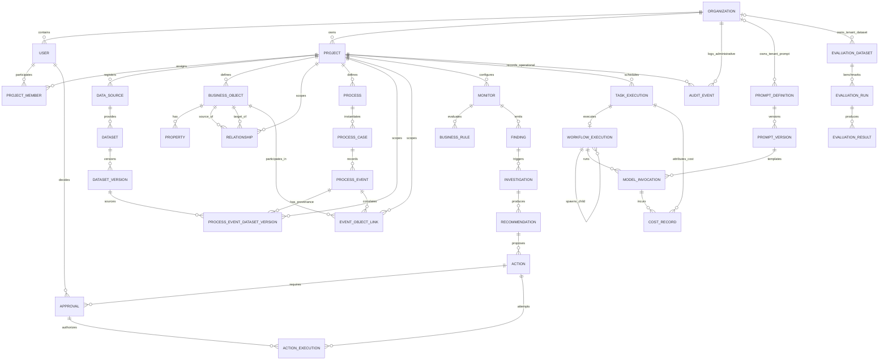
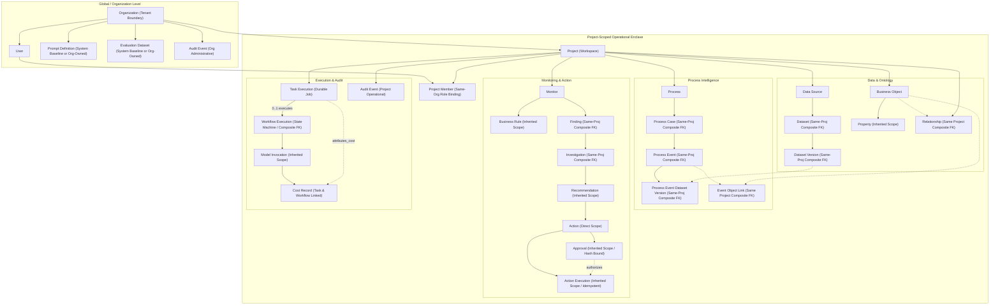
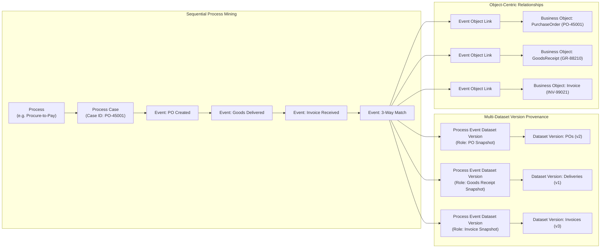
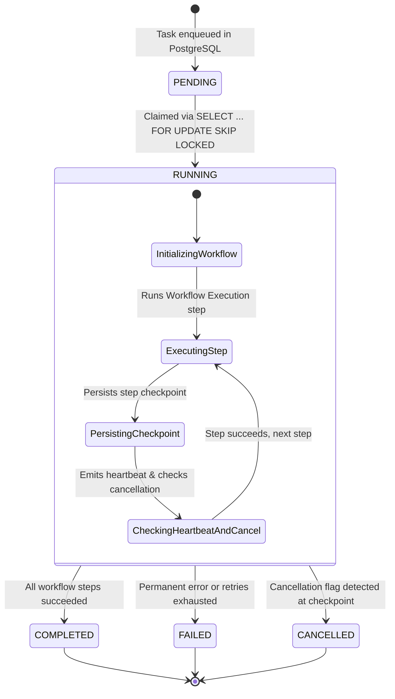
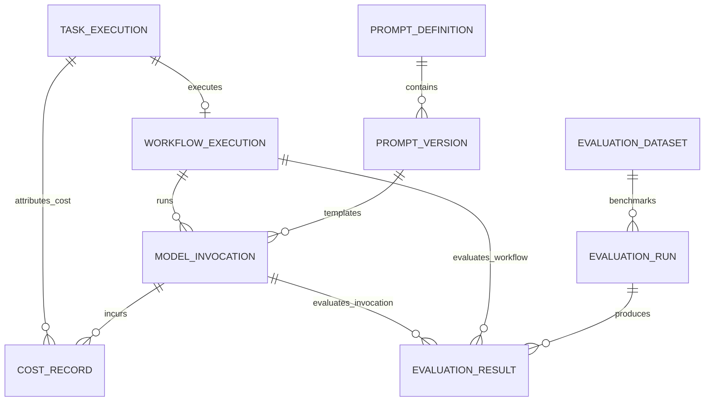

# Corbel — Conceptual Domain Model

## 1. Domain Modeling Philosophy

The Corbel domain model captures the complete operational reality of an enterprise—from raw technical datasets to semantically rich business objects, dynamic process flows, continuous anomaly detection, AI-assisted investigations, and governed human approvals.

> [!NOTE]
> This document defines the **conceptual domain model** of the Corbel platform. It establishes architectural responsibilities, semantic boundaries, ownership paths, and relational cardinalities. It is **not** a database migration specification and does **not** authorize creating all tables during early phases. Conceptual entities are introduced incrementally across the 14-phase implementation roadmap (`docs/IMPLEMENTATION_PLAN.md`) as their corresponding capabilities are developed.

---

## 2. Conceptual Entity Relationship Diagram



---

## 3. Subdomain Boundaries

The conceptual model is organized into seven cohesive subdomains with explicit responsibilities:

```
+---------------------------------------------------------------------------------+
|                            SUBDOMAIN ARCHITECTURE                               |
+---------------------------------------------------------------------------------+
| 1. Tenancy & Access Control  : Organization, User, Project, Project Member      |
| 2. Data Intelligence         : Data Source, Dataset, Dataset Version            |
| 3. Ontology Engine           : Business Object, Property, Relationship          |
| 4. Process Intelligence      : Process, Process Case, Process Event,            |
|                                Process Event Dataset Version, Event Object Link |
| 5. Operational Monitoring    : Monitor, Business Rule, Finding                  |
| 6. Governed Action & Approvals: Investigation, Recommendation, Action,          |
|                                Approval, Action Execution                       |
| 7. Execution, AI & Audit     : Task Execution, Workflow Execution,             |
|                                Model Invocation, Prompt Definition,             |
|                                Prompt Version, Cost Record, Evaluation Dataset, |
|                                Evaluation Run/Result, Audit Event               |
+---------------------------------------------------------------------------------+
```

---

## 4. Entity Catalog

### 4.1. Tenancy & Access Control Subdomain

#### 1. Organization
- **Purpose:** Root multi-tenant boundary representing a distinct enterprise customer or corporate entity.
- **Responsibilities:**
  - Enforces hard tenant isolation across storage, compute, and AI quotas.
  - Maintains enterprise subscription tier, global compliance rules, and billing configurations.
- **Key Attributes:** `id`, `name`, `slug`, `status` (`ACTIVE`, `SUSPENDED`), `created_at`.
- **Ownership/Scope:** Top-level root entity.

#### 2. User
- **Purpose:** Authenticated human actor within an Organization.
- **Responsibilities:**
  - Authenticates into the platform via credentials or enterprise SSO.
  - Holds organization-wide roles (e.g., `ORG_ADMIN`, `MEMBER`, `AUDITOR`).
  - Acts as the designated decision-maker for human approval gates.
- **Key Attributes:** `id`, `organization_id`, `email`, `full_name`, `org_role`, `is_active`, `created_at`.
- **Ownership/Scope:** Belongs to exactly one `Organization`.

#### 3. Project
- **Purpose:** Scoped operational workspace within an Organization (e.g., "Procure-to-Pay Optimization").
- **Responsibilities:**
  - Scopes datasets, ontologies, processes, monitors, investigations, and governed actions.
  - Serves as the primary operational container and cost-attribution boundary.
- **Key Attributes:** `id`, `organization_id`, `name`, `description`, `status`, `created_at`.
- **Ownership/Scope:** Belongs to exactly one `Organization`.

#### 4. Project Member
- **Purpose:** Explicit assignment of a User to a specific Project with contextual permissions.
- **Responsibilities:**
  - Connects a `User` and `Project` belonging to the exact same `Organization`. A user from one Organization must **never** be assigned to a Project belonging to another Organization.
  - Prevents implicit access: belonging to an Organization does **not** grant automatic access to all Projects.
  - Defines project-scoped roles (e.g., `PROJECT_LEAD`, `ANALYST`, `OPERATOR`, `APPROVER`, `VIEWER`).
- **Key Attributes:** `id`, `organization_id`, `project_id`, `user_id`, `project_role`, `granted_at`.
- **Ownership/Scope:** Connects one `Project` and one `User` belonging to the exact same `Organization`. Enforced via deterministic application validation and composite database foreign keys:
  `FOREIGN KEY (organization_id, user_id) REFERENCES users(organization_id, id)`
  `FOREIGN KEY (organization_id, project_id) REFERENCES projects(organization_id, id)`

---

### 4.2. Data Intelligence Subdomain

#### 5. Data Source
- **Purpose:** Configured connection to an external database, data lake, or file ingestion directory.
- **Responsibilities:**
  - Encapsulates network endpoints, drivers, and encrypted credentials.
  - Exposes read-only schema introspection and query extraction capabilities.
- **Key Attributes:** `id`, `project_id`, `name`, `source_type` (`POSTGRES`, `MYSQL`, `SNOWFLAKE`, `FILE_INGEST`), `connection_config_encrypted`, `status`.
- **Ownership/Scope:** Scoped directly to `Project` (Direct Project Scope).

#### 6. Dataset
- **Purpose:** Logical tabular data asset discovered or extracted from a Data Source (e.g., `raw_purchase_orders`, `erp_invoices`).
- **Responsibilities:**
  - Maintains logical dataset identity, source mapping, and high-level catalog metadata.
  - Acts as the parent container for versioned dataset extractions.
- **Key Attributes:** `id`, `data_source_id`, `project_id`, `table_name`, `created_at`.
- **Ownership/Scope:** Provided by one `Data Source`; scoped directly to `Project` (Direct Project Scope). Must belong to the exact same Project as its Data Source. Enforced via composite database foreign key:
  `FOREIGN KEY (project_id, data_source_id) REFERENCES data_sources(project_id, id)`

#### 7. Dataset Version
- **Purpose:** Immutable snapshot representing a particular extraction, schema state, profiling summary, and import context of a Dataset.
- **Responsibilities:**
  - Records column data types, statistical profiles, null ratios, row counts, and checksum hashes at a specific point in time.
  - Strictly immutable once successfully created: new imports create new `Dataset Version` records rather than silently mutating historical snapshots.
  - Serves as the provenance anchor for reproducibility: ontology discovery, property mappings, and process event reconstructions retain explicit references to the exact `Dataset Version`(s) used.
- **Key Attributes:** `id`, `dataset_id`, `project_id`, `version_number`, `schema_metadata_json`, `record_count`, `checksum_hash`, `imported_at`.
- **Ownership/Scope:** Versions one `Dataset`; scoped directly to `Project` (Direct Project Scope). Must belong to the exact same Project as its parent Dataset. Enforced via composite database foreign key:
  `FOREIGN KEY (project_id, dataset_id) REFERENCES datasets(project_id, id)`

---

### 4.3. Ontology Engine Subdomain

#### 8. Business Object
- **Purpose:** Semantic enterprise entity representing a core operational concept (e.g., `Supplier`, `PurchaseOrder`, `GoodsReceipt`, `Invoice`).
- **Responsibilities:**
  - Maps one or more underlying technical Datasets/Dataset Versions into a standardized business concept.
  - Retains explicit provenance: source mappings record the exact `dataset_version_id`(s) used during discovery and mapping.
  - Serves as the anchor for operational queries, monitors, and actions.
- **Key Attributes:** `id`, `project_id`, `name`, `display_name`, `description`, `primary_key_property`, `version`.
- **Ownership/Scope:** Defined within exactly one `Project` (Direct Project Scope).

#### 9. Property
- **Purpose:** Strongly-typed business attribute belonging to a Business Object (e.g., `order_total_usd`, `invoice_amount`, `promised_delivery_date`).
- **Responsibilities:**
  - Defines business data type, validation constraints, and source dataset column mappings.
  - Retains source dataset column references and corresponding `dataset_version_id` in `source_mapping_json`.
- **Key Attributes:** `id`, `business_object_id`, `name`, `data_type` (`STRING`, `NUMBER`, `DATETIME`, `BOOLEAN`, `ENUM`), `is_nullable`, `source_mapping_json`.
- **Ownership/Scope:** Belongs to exactly one `Business Object` (Inherited Project Scope via `business_object_id`).

#### 10. Relationship
- **Purpose:** Directed semantic link connecting two Business Objects (e.g., `Supplier` -> *supplies* -> `PurchaseOrder`, `PurchaseOrder` -> *billed_by* -> `Invoice`).
- **Responsibilities:**
  - Defines cardinality (one-to-one, one-to-many, many-to-many) and join expressions.
  - Owned directly by the `Project`, referencing a source `Business Object` and target `Business Object`.
- **Key Attributes:** `id`, `project_id`, `name`, `source_object_id`, `target_object_id`, `cardinality`, `join_expression_json`.
- **Ownership/Scope:** Directly scoped to `Project` (Direct Project Scope); references source and target `Business Object`s using composite foreign keys requiring both to belong to the exact same Project.

---

### 4.4. Process Intelligence Subdomain

#### 11. Process
- **Purpose:** End-to-end operational workflow definition (e.g., `Procure-to-Pay`).
- **Responsibilities:**
  - Aggregates lifecycle events, defines milestone sequences, and tracks SLA targets.
- **Key Attributes:** `id`, `project_id`, `name`, `description`, `target_duration_seconds`, `is_active`.
- **Ownership/Scope:** Scoped directly to `Project` (Direct Project Scope).

#### 12. Process Case
- **Purpose:** Concrete instance of an operational workflow execution (e.g., PO #4500192831 lifecycle).
- **Responsibilities:**
  - Tracks the end-to-end execution path, variant classification, start/end timestamps, total cycle time, and completion status.
  - Serves as the primary correlation instance for sequential event mining.
- **Key Attributes:** `id`, `process_id`, `project_id`, `case_identifier`, `variant_key`, `status` (`ACTIVE`, `COMPLETED`, `ABANDONED`), `started_at`, `ended_at`, `total_duration_seconds`.
- **Ownership/Scope:** Instantiated under one `Process`; scoped directly to `Project` (Direct Project Scope). Enforced via composite database foreign key:
  `FOREIGN KEY (project_id, process_id) REFERENCES processes(project_id, id)`

#### 13. Process Event
- **Purpose:** Atomic, timestamped activity occurrence within a process lifecycle (e.g., "PO Approved", "Goods Delivered", "3-Way Match Executed").
- **Responsibilities:**
  - Represents the fundamental unit of process analysis.
  - Records activity name, event lifecycle timestamp, source provenance, resource/actor, and custom attributes.
  - Retains source provenance. May carry an optional primary-source `dataset_version_id` reference; comprehensive multi-source snapshot provenance is authoritatively tracked via `Process Event Dataset Version` association entities to support multi-dataset event reconstruction (e.g., PO, Goods Receipt, and Invoice snapshots in a 3-way match).
- **Key Attributes:** `id`, `process_case_id`, `project_id`, `dataset_version_id` (optional primary-source reference), `activity_name`, `timestamp`, `event_type` (`START`, `COMPLETE`), `resource`, `source_system`, `source_record_id`, `attributes_json`.
- **Ownership/Scope:** Recorded under one `Process Case`; scoped directly to `Project` (Direct Project Scope). Enforced via composite foreign keys:
  `FOREIGN KEY (project_id, process_case_id) REFERENCES process_cases(project_id, id)`
  When the optional primary `dataset_version_id` is populated, same-project referential integrity is guaranteed at the database schema level via:
  `FOREIGN KEY (project_id, dataset_version_id) REFERENCES dataset_versions(project_id, id)`
  (A null `dataset_version_id` indicates no single-source primary dataset version is designated; multi-source provenance is authoritatively tracked via `Process Event Dataset Version`).

#### 14. Process Event Dataset Version
- **Purpose:** Conceptual association entity linking a Process Event to one or more immutable Dataset Versions used during event extraction and process reconstruction.
- **Responsibilities:**
  - Connects one Process Event to one or more Dataset Versions, preserving the exact source snapshots used during multi-dataset event reconstruction (e.g., PO, Goods Receipt, and Invoice datasets in 3-way matching).
  - Enforces same-project membership between the Process Event and Dataset Version at the relational level via composite foreign keys.
  - Records optional provenance roles (e.g., `PURCHASE_ORDER`, `GOODS_RECEIPT`, `INVOICE`) and transformation logic references for full auditability and reproducible process mining.
  - Supports reproducibility, root cause analysis, and systematic investigation of event reconstruction.
- **Key Attributes:** `id`, `project_id`, `process_event_id`, `dataset_version_id`, `provenance_role` (optional), `transformation_reference` (optional), `created_at`.
- **Ownership/Scope:** Scoped directly to `Project` (Direct Project Scope). Guarantees same-project integrity between the event and dataset version via composite foreign keys:
  `FOREIGN KEY (project_id, process_event_id) REFERENCES process_events(project_id, id)`
  `FOREIGN KEY (project_id, dataset_version_id) REFERENCES dataset_versions(project_id, id)`

#### 15. Event Object Link
- **Purpose:** Object-centric process link associating a single Process Event with multiple participating Business Objects.
- **Responsibilities:**
  - Overcomes the limitation of single Case IDs for complex enterprise flows.
  - Allows an event (e.g., "3-Way Match") to correlate simultaneously with `PurchaseOrder`, `GoodsReceipt`, and `Invoice` objects.
  - Enforces same-project membership at the database level via composite foreign keys.
- **Key Attributes:** `id`, `project_id`, `process_event_id`, `business_object_id`, `business_record_id`, `object_role`.
- **Ownership/Scope:** Scoped directly to `Project` (Direct Project Scope). Uses composite foreign keys to guarantee at the database level that both the correlated `Process Event` and `Business Object` belong to the exact same Project:
  `FOREIGN KEY (project_id, process_event_id) REFERENCES process_events(project_id, id)`
  `FOREIGN KEY (project_id, business_object_id) REFERENCES business_objects(project_id, id)`

---

### 4.5. Operational Monitoring Subdomain

#### 16. Monitor
- **Purpose:** Automated operational observer configured to run continuously or on a defined schedule.
- **Responsibilities:**
  - Evaluates operational rules against process events and business object states.
  - Emits Findings upon detecting anomalies, SLA breaches, or policy deviations.
- **Key Attributes:** `id`, `project_id`, `name`, `schedule_cron`, `status` (`ACTIVE`, `PAUSED`), `last_run_at`.
- **Ownership/Scope:** Configured within exactly one `Project` (Direct Project Scope).

#### 17. Business Rule
- **Purpose:** Deterministic constraint or metric threshold evaluated by a Monitor.
- **Responsibilities:**
  - Evaluated mathematically in deterministic Python/SQL (e.g., price variance > 0.5%, delivery delay > 5 business days).
- **Key Attributes:** `id`, `monitor_id`, `rule_code`, `description`, `rule_expression`, `severity` (`LOW`, `MEDIUM`, `HIGH`, `CRITICAL`).
- **Ownership/Scope:** Belongs to one `Monitor` (Inherited Project Scope via `monitor_id`). Derives its project scope strictly from its parent Monitor without crossing project boundaries.

#### 18. Finding
- **Purpose:** Detected operational exception, bottleneck, or SLA violation emitted by a Monitor.
- **Responsibilities:**
  - Captures violating records, verified factual context, timestamp, and severity.
  - Serves as the anchor for subsequent human review or AI-assisted investigations.
  - May trigger zero, one, or multiple Investigations across its lifecycle (supporting re-investigations or competing hypotheses).
- **Lifecycle States:** `OPEN` → `INVESTIGATING` → `RECOMMENDED` → `RESOLVED` / `DISMISSED`.
- **Key Attributes:** `id`, `monitor_id`, `project_id`, `severity`, `status`, `summary`, `verified_context_json`, `detected_at`.
- **Ownership/Scope:** Emitted by one `Monitor`; scoped directly to `Project` (Direct Project Scope). Enforced via composite foreign key:
  `FOREIGN KEY (project_id, monitor_id) REFERENCES monitors(project_id, id)`

---

### 4.6. Governed Action & Approvals Subdomain

#### 19. Investigation
- **Purpose:** Analytical session examining the root causes and operational/financial impact of a Finding.
- **Responsibilities:**
  - Invokes bounded AI workflows to query related records and synthesize evidence.
  - Explicitly separates **verified facts** from **causal hypotheses**.
  - Calculates deterministic financial impact.
- **Lifecycle States:** `PENDING` → `RUNNING` → `COMPLETED` → `FAILED` / `CANCELLED`.
- **Key Attributes:** `id`, `finding_id`, `project_id`, `status`, `verified_facts_json`, `causal_hypothesis`, `financial_impact_usd`, `created_at`.
- **Ownership/Scope:** Investigates one `Finding`; scoped directly to `Project` (Direct Project Scope). Enforced via composite foreign key:
  `FOREIGN KEY (project_id, finding_id) REFERENCES findings(project_id, id)`

#### 20. Recommendation
- **Purpose:** Structured proposal produced by an Investigation to resolve or mitigate a Finding.
- **Responsibilities:**
  - Formulates candidate remedial Actions with confidence scores, rationale, and estimated risk levels.
- **Key Attributes:** `id`, `investigation_id`, `title`, `description`, `confidence_score`, `risk_level` (`LOW`, `MEDIUM`, `HIGH`).
- **Ownership/Scope:** Produced by one `Investigation` (Inherited Project Scope via `investigation_id`). Derives its project boundary deterministically through its parent Investigation without requiring a redundant direct attribute.

#### 21. Action
- **Purpose:** Specific, parameterized operation designed to alter internal or external system state (e.g., `HoldInvoice`, `RequestCreditMemo`, `FlagSupplierReview`).
- **Responsibilities:**
  - Encapsulates target action type, exact execution payload, and validation schemas.
  - Tracks governance requirements: consequential actions require human approval prior to dispatch.
- **Lifecycle States:** `DRAFT` → `AWAITING_APPROVAL` → `APPROVED` → `EXECUTING` → `EXECUTED` / `FAILED` / `REJECTED`.
- **Key Attributes:** `id`, `recommendation_id`, `project_id`, `action_type`, `target_system`, `approved_payload_json`, `is_consequential`.
- **Ownership/Scope:** Proposed by a `Recommendation`; scoped directly to `Project` (Direct Project Scope). Same-project referential integrity between `Action` and the `Recommendation`'s parent `Investigation` is enforced at the database level via a composite foreign key `FOREIGN KEY (project_id, recommendation_id) REFERENCES recommendations(project_id, id)` (paired with a candidate key on `recommendations(project_id, id)`), or via a PostgreSQL database `CONSTRAINT TRIGGER` verifying that `NEW.project_id == (SELECT i.project_id FROM recommendations r JOIN investigations i ON r.investigation_id = i.id WHERE r.id = NEW.recommendation_id)`.

#### 22. Approval
- **Purpose:** Formal human authorization gate binding an authorized user decision to the exact action payload.
- **Responsibilities:**
  - Presents human decision-makers with finding context, verified evidence, hypothesis, and exact proposed payload.
  - Serializes the exact proposed payload deterministically (canonical JSON with sorted keys and standardized formatting) and computes `approved_payload_hash` upon authorization.
  - Retains the exact approved payload as protected immutable evidence, or through a secure immutable reference.
  - A changed action payload invalidates prior approvals and strictly requires a new approval; previous approvals never automatically authorize modified payloads.
  - An expired, revoked, rejected, or otherwise invalid approval cannot authorize execution.
  - Supports multiple approval attempts across revisions or re-requests.
- **Lifecycle States:** `PENDING` → `APPROVED` / `REJECTED` / `EXPIRED` / `REVOKED`.
- **Key Attributes:** `id`, `action_id`, `assigned_role`, `decided_by_user_id`, `status`, `approved_payload_hash`, `approved_payload_json`, `decision_rationale`, `decided_at`, `expires_at`.
- **Ownership/Scope:** Governs one `Action` (Inherited Project Scope via `action_id`). Derives project boundary from parent Action. Maintains a unique candidate key on `(action_id, id)` to support database-enforced same-action referential integrity from `Action Execution`.

#### 23. Action Execution
- **Purpose:** Attempt to execute an approved Action against a target adapter (`SimulatedTargetAdapter` initially).
- **Responsibilities:**
  - Binds to a single logical external operation identified by a persisted `idempotency_key`. Retries of the same logical operation reuse the original key; a new key is generated only for a genuinely new logical operation. Individual dispatch attempts are tracked separately (`attempt_count`).
  - Every consequential Action Execution must reference the specific Approval (`approval_id`) that authorizes it.
  - The referenced Approval must belong to the exact same Action (`approval.action_id == action_execution.action_id`).
  - The referenced Approval must be valid, unexpired, not revoked, and approved (`status == APPROVED`).
  - Immediately before dispatch, computes `dispatched_payload_hash` from the canonicalized outgoing payload (applying the identical deterministic canonicalization rules used during approval) and compares it against the referenced Approval's `approved_payload_hash`.
  - Rejects execution immediately if the referenced approval is invalid or if the hashes do not match (`dispatched_payload_hash != approved_payload_hash`).
  - Retains `approval_id` and `dispatched_payload_hash` as immutable execution evidence.
  - Preserves the ability to have multiple approval attempts across action revisions without implying that a prior approval automatically authorizes a modified payload.
  - Tracks execution outcomes, failure reasons, and triggers reconciliation or compensating flows when external status is ambiguous.
- **Lifecycle States:** `QUEUED` → `DISPATCHING` → `SUCCEEDED` / `FAILED` / `RECONCILIATION_REQUIRED`.
- **Key Attributes:** `id`, `action_id`, `approval_id`, `idempotency_key`, `target_adapter_type`, `status`, `attempt_count`, `dispatched_payload_json`, `dispatched_payload_hash`, `adapter_response_json`, `dispatched_at`, `completed_at`.
- **Ownership/Scope:** Executes one `Action` (Inherited Project Scope via `action_id`), authorized by an Approval belonging to the same Action. Same-action referential integrity is guaranteed at the database schema level via a composite foreign key:
  `FOREIGN KEY (action_id, approval_id) REFERENCES approvals(action_id, id)`
  matching the candidate key on `approvals(action_id, id)`. Referential integrity at the database level guarantees that the approval belongs to the exact same action. Deterministic runtime validation separately verifies that the approval is currently approved, unexpired, unrevoked, granted by an authorized actor, and that its canonicalized payload hash exactly matches the dispatched payload hash.

---

### 4.7. Execution, AI & Audit Subdomain

#### 24. Task Execution
- **Purpose:** Durable background job entity managing the operational lifecycle, claiming, lease, and recovery of asynchronous jobs in PostgreSQL.
- **Responsibilities:**
  - Manages durable job lifecycle (`PENDING` → `RUNNING` → `COMPLETED` / `FAILED` / `CANCELLED`).
  - Supports safe concurrent task claiming via `SELECT ... FOR UPDATE SKIP LOCKED` by preventing multiple workers from claiming the same available task during the same claim cycle. (Reliable execution and recovery also depend on time-bounded worker leases, heartbeat monitoring, lease ownership validation, checkpoint recovery, idempotent operations, and bounded retries to handle stale workers and ambiguous external outcomes).
  - Tracks worker leases, heartbeat monitoring, and safe checkpoint resumption.
  - Enforces bounded retries with backoff and graceful worker shutdown.
  - Executes long-running tasks: may execute zero or one primary `Workflow Execution` (`TASK_EXECUTION ||--o| WORKFLOW_EXECUTION : executes`), or execute plain deterministic background jobs (such as CSV parsing, dataset schema profiling, or scheduled maintenance sweeps).
- **Lifecycle States:** `PENDING` → `RUNNING` → `COMPLETED` / `FAILED` / `CANCELLED`.
- **Key Attributes:** `id`, `project_id`, `task_type` (`DATASET_IMPORT`, `SCHEMA_PROFILING`, `WORKFLOW_RUN`, `MONITOR_SWEEP`), `status`, `worker_id`, `lease_expires_at`, `last_heartbeat_at`, `retry_count`, `max_retries`, `checkpoint_data_json`, `cancellation_requested`, `started_at`, `ended_at`, `error_diagnostics_json`.
- **Ownership/Scope:** Scoped directly to `Project` (Direct Project Scope).

#### 25. Workflow Execution
- **Purpose:** Business or AI workflow execution record governing specific analytical state machine transitions and step iteration bounds.
- **Responsibilities:**
  - Tracks workflow identity, version, inputs, outputs, current state, and step counts against hard caps.
  - Executed within the context of a `Task Execution` (0..1 cardinality from Task Execution: a task execution executes zero or one primary workflow execution).
  - Supports hierarchical execution via optional parent-child execution references (`parent_execution_id`).
- **Lifecycle States:** `INITIALIZED` → `STEPPING` → `COMPLETED` / `FAILED` / `CANCELLED`.
- **Key Attributes:** `id`, `task_execution_id`, `project_id`, `workflow_type` (`DATA_DISCOVERY`, `PROCESS_MINING`, `INVESTIGATION`, `RULE_GENERATION`), `workflow_version`, `status`, `current_state`, `step_count`, `max_steps`, `input_parameters_json`, `result_data_json`, `parent_execution_id`, `started_at`, `ended_at`.
- **Ownership/Scope:** Scoped directly to `Project` (Direct Project Scope); executed by one `Task Execution`. Enforced via composite foreign key: `FOREIGN KEY (project_id, task_execution_id) REFERENCES task_executions(project_id, id)`.

#### 26. Model Invocation
- **Purpose:** Atomic call to an underlying hosted LLM provider via the Model Gateway.
- **Responsibilities:**
  - Captures provider name, model identifier, tokens, cached tokens, latency, telemetry trace IDs, and provider-level call outcome (`model_call_outcome`).
  - Optionally links to a versioned `Prompt Version` template (if a template was used).
- **Key Attributes:** `id`, `workflow_execution_id`, `prompt_version_id`, `provider_name`, `model_name`, `input_tokens`, `output_tokens`, `cached_input_tokens`, `latency_ms`, `model_call_outcome` (`SUCCESS`, `PROVIDER_ERROR`, `RATE_LIMITED`, `TIMEOUT`, `VALIDATION_FAILED`), `provider_request_id`, `trace_id`, `span_id`.
- **Ownership/Scope:** Belongs to one `Workflow Execution` (Inherited Project Scope via `workflow_execution_id`). Derives project scope strictly through its parent Workflow Execution.

#### 27. Prompt Definition
- **Purpose:** Named logical prompt asset representing a specific enterprise prompt capability (e.g., `QueryCompilationPrompt`, `P2PInvestigationPrompt`).
- **Responsibilities:**
  - Holds prompt ownership, description, target workflow, and change management metadata.
  - Distinguishes platform-wide system prompts from organization prompts via `is_system` and nullable `organization_id`:
    - System assets are platform-owned baseline assets shared across organizations (`is_system=True`, `organization_id=None`). System assets are immutable baseline assets.
    - Organization-owned assets belong to exactly one Organization (`is_system=False`, `organization_id` mandatory).
    - Tenant users cannot modify platform-wide system baselines.
    - An organization cannot modify or access another organization's private prompt assets.
    - Tenant-specific customizations must create organization-owned assets or versions rather than modifying shared system baselines.
- **Key Attributes:** `id`, `organization_id`, `is_system`, `name`, `workflow_association`, `description`, `owner_user_id`, `created_at`.
- **Ownership/Scope:** Platform-wide system asset (`is_system=True`, `organization_id=None`) or scoped to `Organization` (`is_system=False`, `organization_id` mandatory).

#### 28. Prompt Version
- **Purpose:** Immutable, version-controlled iteration of a Prompt Definition.
- **Responsibilities:**
  - Manages prompt text, Pydantic input/output schemas, model compatibility, and token budgets.
  - Strictly immutable: existing prompt versions are **never** modified in place. Any change creates a new `Prompt Version`.
  - Supports instant production rollback by restoring the active deployment reference to a previously approved immutable prompt version; historical versions remain unchanged.
  - Governs formal lifecycle progression: `DRAFT` → `TEST` → `EVALUATE` → `APPROVE` → `DEPLOY` → `MONITOR` → `RETIRE`.
- **Lifecycle States:** `DRAFT` → `TEST` → `EVALUATE` → `APPROVE` → `DEPLOY` → `MONITOR` → `RETIRE`.
- **Key Attributes:** `id`, `prompt_definition_id`, `version_tag`, `lifecycle_state`, `model_compatibility`, `token_budget_input`, `token_budget_output`, `template_text`, `created_at`.
- **Ownership/Scope:** Versions one `Prompt Definition`.

#### 29. Cost Record
- **Purpose:** Granular financial accounting entry recording expenditure for AI model invocations.
- **Responsibilities:**
  - Captures estimated or actual cost in USD based on provider billing parameters and token breakdowns.
  - Linked to `Model Invocation` (`model_invocation_id`) and explicitly attributed to the responsible `Task Execution` (`task_execution_id`, where applicable).
  - The `Task Execution` must match the task associated with the Model Invocation's Workflow Execution.
  - Task-level attribution enables cost-per-task and cost-per-successful-task reporting.
  - Organization and Project attribution must strictly agree with the execution chain (`task_execution_id` -> `workflow_execution_id` -> `model_invocation_id`).
  - Utility model invocations without a Task Execution may be supported only where the architecture explicitly permits them (e.g., ad-hoc developer interactive queries or isolated lightweight utilities where no durable background task is scheduled).
  - Explicitly separates three distinct outcome tiers:
    - `model_call_outcome` (`SUCCESS`, `PROVIDER_ERROR`, `RATE_LIMITED`, `TIMEOUT`, `VALIDATION_FAILED`)
    - `workflow_outcome` (`SUCCESS`, `PARTIAL_SUCCESS`, `FAILED`, `CANCELLED`)
    - `task_outcome` (`COMPLETED`, `FAILED`, `CANCELLED`)
  - Ensures a successful model call is never conflated with a successful business task. Calculating **Cost per Successful Task** requires `task_outcome == COMPLETED` and `workflow_outcome == SUCCESS`.
  - Enables multi-dimensional cost aggregation (by Organization, Project, Use Case, Workflow, Agent, and Model).
- **Key Attributes:** `id`, `model_invocation_id`, `task_execution_id`, `organization_id`, `project_id`, `use_case`, `workflow_name`, `cost_usd`, `model_call_outcome`, `workflow_outcome`, `task_outcome`, `pricing_tier_snapshot_json`, `is_estimated`, `timestamp`.
- **Ownership/Scope:** Incurred by one `Model Invocation`; attributed directly to `Task Execution` (where applicable), `Project`, and `Organization` (Direct Project Scope). Execution-chain referential integrity is enforced at the database level via composite foreign keys:
  `FOREIGN KEY (workflow_execution_id, model_invocation_id) REFERENCES model_invocations(workflow_execution_id, id)`
  `FOREIGN KEY (task_execution_id, workflow_execution_id) REFERENCES workflow_executions(task_execution_id, id)` (where `task_execution_id` is non-null)
  `FOREIGN KEY (organization_id, project_id) REFERENCES projects(organization_id, id)`
  A transactional persistence boundary and constraint triggers ensure that `organization_id` and `project_id` strictly agree with the associated execution chain. Standalone utility model calls where no durable task execution is scheduled are permitted with a null `task_execution_id`.

#### 30. Evaluation Dataset
- **Purpose:** Versioned golden test dataset used for AI regression testing and quality benchmarking.
- **Responsibilities:**
  - Stores input prompts, expected ground-truth facts, and expected tool call sequences.
  - Distinguishes platform-wide system datasets from organization datasets via `is_system` and nullable `organization_id`:
    - System assets are platform-owned baseline assets shared across organizations (`is_system=True`, `organization_id=None`). System assets are immutable baseline assets.
    - Organization-owned datasets belong to exactly one Organization (`is_system=False`, `organization_id` mandatory).
    - Tenant users cannot modify platform-wide system baselines.
    - An organization cannot modify or access another organization's private evaluation datasets.
    - Tenant-specific customizations must create organization-owned evaluation datasets rather than modifying shared system baselines.
- **Key Attributes:** `id`, `organization_id`, `is_system`, `name`, `version`, `domain`, `test_cases_json`, `created_at`.
- **Ownership/Scope:** Managed at platform-wide system level (`is_system=True`, `organization_id=None`) or scoped to `Organization` (`is_system=False`, `organization_id` mandatory).

#### 31. Evaluation Run & Result
- **Purpose:** Execution and scoring records of an automated evaluation suite against a prompt, model, or workflow.
- **Responsibilities:**
  - Runs test cases, calculates metric scores (grounding, tool precision, schema compliance, business correctness), and identifies regressions.
  - Can evaluate an end-to-end `Workflow Execution` or an individual `Model Invocation`.
  - Retains appropriate organization ownership and execution scope: evaluation results cannot reference executions belonging to a different organization or project from their evaluation run, where project-scoped evaluation is used.
- **Key Attributes:**
  - `EvaluationRun`: `id`, `organization_id`, `evaluation_dataset_id`, `target_prompt_version_id`, `target_model_name`, `status`, `started_at`, `ended_at`.
  - `EvaluationResult`: `id`, `evaluation_run_id`, `workflow_execution_id`, `model_invocation_id`, `metric_name`, `score`, `passed`, `diagnostics_json`.
- **Ownership/Scope:** `Evaluation Run` is scoped to `Organization` (Direct Organization Scope); `Evaluation Result` inherits scope via its parent `Evaluation Run` and evaluated execution entity (Inherited Scope).

#### 32. Audit Event
- **Purpose:** Immutable, append-only record capturing authoritative historical proof of system operations and administrative changes.
- **Responsibilities:**
  - Records administrative changes, configuration/policy updates, human approval and rejection decisions, action execution attempts, and workflow lifecycle transitions.
  - Supports organization-level administrative events (where `project_id` is null) and project-scoped operational events (where both `organization_id` and `project_id` are populated).
  - Sanitizes sensitive payloads: strictly excludes secrets and credentials, redacts unnecessary PII, and stores hashes or references rather than raw document dumps.
  - Preserves exact approved payload evidence via deterministic canonicalization and SHA-256 hash (`approved_payload_hash`) to provide cryptographic verification of canonicalized payload integrity.
- **Key Attributes:** `id`, `organization_id`, `project_id`, `actor_type` (`USER`, `SYSTEM_WORKER`, `API_KEY`), `actor_id`, `action_type`, `affected_entity_type`, `affected_entity_id`, `execution_context_json`, `outcome_status`, `ip_address`, `timestamp`.
- **Ownership/Scope:** Append-only record scoped to `Organization` (mandatory) and optionally `Project`. Enforced at the database level via a composite foreign key:
  `FOREIGN KEY (organization_id, project_id) REFERENCES projects(organization_id, id)`
  Under standard SQL MATCH SIMPLE foreign key semantics in PostgreSQL, a null `project_id` represents an organization-level administrative event; when `project_id` is non-null, it is guaranteed to belong to that exact same `Organization`. An audit event cannot reference a project belonging to a different organization.

---

## 5. Explicit Ownership & Same-Project Referential Integrity Invariants



### Direct vs. Inherited Project Scope Pattern

Corbel establishes two consistent project-scoping patterns across all entities:

1. **Direct Project Scope:** The entity explicitly stores `project_id` and uses composite foreign keys where cross-entity referential integrity within the same project is required.
   - *Direct Entities:* `Data Source`, `Dataset`, `Dataset Version`, `Business Object`, `Relationship`, `Process`, `Process Case`, `Process Event`, `Process Event Dataset Version`, `Event Object Link`, `Monitor`, `Finding`, `Investigation`, `Action`, `Task Execution`, `Workflow Execution`, `Cost Record`, `Audit Event` (operational).
   - *Composite FK Enforcement:* Relational schema constraints guarantee same-project membership across parent-child links. Repository or application-level query filtering alone is **never** treated as the integrity mechanism.

2. **Inherited Project Scope:** The entity derives its project scope deterministically from its parent entity, enforced through standard relational foreign keys and deterministic application validation, without storing redundant `project_id` columns:
   - *Inherited Entities:*
     - `Property`: derives project scope from parent `Business Object` (`business_object_id`).
     - `Business Rule`: derives project scope from parent `Monitor` (`monitor_id`).
     - `Recommendation`: derives project scope from parent `Investigation` (`investigation_id`).
     - `Approval`: derives project scope from parent `Action` (`action_id`).
     - `Action Execution`: derives project scope from parent `Action` (`action_id`) and validates authorization against `approval_id`.
     - `Model Invocation`: derives project scope from parent `Workflow Execution` (`workflow_execution_id`).
     - `Evaluation Result`: derives organization and execution scope from parent `Evaluation Run` and evaluated execution target.

### Parent-Child Relationships & Referential Integrity Invariants

The table below defines the complete referential integrity matrix for all project-scoped and hierarchical parent-child relationships, ensuring entities cannot cross Project or Tenant boundaries:

| Child Entity | Parent Entity | Scope Type | Integrity Enforcement Mechanism |
| :--- | :--- | :--- | :--- |
| `Dataset` | `Data Source` | Direct Project Scope | Composite database foreign key: `FOREIGN KEY (project_id, data_source_id) REFERENCES data_sources(project_id, id)` |
| `Dataset Version` | `Dataset` | Direct Project Scope | Composite database foreign key: `FOREIGN KEY (project_id, dataset_id) REFERENCES datasets(project_id, id)` |
| `Process Case` | `Process` | Direct Project Scope | Composite database foreign key: `FOREIGN KEY (project_id, process_id) REFERENCES processes(project_id, id)` |
| `Process Event` | `Process Case` | Direct Project Scope | Composite database foreign key: `FOREIGN KEY (project_id, process_case_id) REFERENCES process_cases(project_id, id)` |
| `Process Event (Primary)` | `Dataset Version` | Direct Project Scope | Composite database foreign key: `FOREIGN KEY (project_id, dataset_version_id) REFERENCES dataset_versions(project_id, id)` with nullable `dataset_version_id` (PostgreSQL `MATCH SIMPLE` semantics: if NULL, FK constraint is satisfied; if populated, both `project_id` and `dataset_version_id` must match) |
| `Process Event Dataset Version` | `Process Event` & `Dataset Version` | Direct Project Scope | Composite foreign keys to both parents: `FOREIGN KEY (project_id, process_event_id) REFERENCES process_events(project_id, id)` and `FOREIGN KEY (project_id, dataset_version_id) REFERENCES dataset_versions(project_id, id)` |
| `Event Object Link` | `Process Event` & `Business Object` | Direct Project Scope | Composite foreign keys to both parents: `FOREIGN KEY (project_id, process_event_id) REFERENCES process_events(project_id, id)` and `FOREIGN KEY (project_id, business_object_id) REFERENCES business_objects(project_id, id)` |
| `Property` | `Business Object` | Inherited Project Scope | Standard foreign key `business_object_id`; derives project scope strictly from parent `Business Object` |
| `Relationship` | `Business Object` (Source & Target) | Direct Project Scope | Composite foreign keys to both business objects: `FOREIGN KEY (project_id, source_object_id) REFERENCES business_objects(project_id, id)` and `FOREIGN KEY (project_id, target_object_id) REFERENCES business_objects(project_id, id)` |
| `Business Rule` | `Monitor` | Inherited Project Scope | Standard FK `monitor_id`; derives project scope strictly from parent `Monitor` |
| `Finding` | `Monitor` | Direct Project Scope | Composite database foreign key: `FOREIGN KEY (project_id, monitor_id) REFERENCES monitors(project_id, id)` |
| `Investigation` | `Finding` | Direct Project Scope | Composite database foreign key: `FOREIGN KEY (project_id, finding_id) REFERENCES findings(project_id, id)` |
| `Recommendation` | `Investigation` | Inherited Project Scope | Standard FK `investigation_id`; derives project scope strictly from parent `Investigation` |
| `Action` | `Recommendation` | Direct Project Scope | Direct `project_id`; links to parent `Recommendation`. Enforced via candidate key on `recommendations(project_id, id)` with `FOREIGN KEY (project_id, recommendation_id) REFERENCES recommendations(project_id, id)`, or database `CONSTRAINT TRIGGER` verifying `recommendation.investigation.project_id == action.project_id` |
| `Approval` | `Action` | Inherited Project Scope | Candidate key on `approvals(action_id, id)`; standard FK `FOREIGN KEY (action_id) REFERENCES actions(id)`; derives project scope strictly from parent `Action` |
| `Action Execution` | `Action` & `Approval` | Inherited Project Scope | Composite database foreign key: `FOREIGN KEY (action_id, approval_id) REFERENCES approvals(action_id, id)`. Relational schema integrity guarantees the approval exists and belongs to the same Action; deterministic runtime validation verifies approval status (`APPROVED`), unexpired, unrevoked, and canonicalized payload hash equality |
| `Workflow Execution` | `Task Execution` | Direct Project Scope | Composite database foreign key: `FOREIGN KEY (project_id, task_execution_id) REFERENCES task_executions(project_id, id)` (0..1 cardinality from Task Execution) |
| `Model Invocation` | `Workflow Execution` | Inherited Project Scope | Standard FK `workflow_execution_id`; derives project scope strictly from parent `Workflow Execution` |
| `Cost Record` | Execution Chain | Direct Project & Org Scope | Direct `organization_id`, `project_id`, `task_execution_id`, `model_invocation_id`. Composite FK `FOREIGN KEY (project_id, task_execution_id) REFERENCES task_executions(project_id, id)`; execution-chain consistency trigger / transactional boundary (`cost_records` -> `model_invocations` -> `workflow_executions` -> `task_executions`) |
| `Audit Event` | `Organization` & `Project` | Tenant / Workspace Scope | Direct `organization_id`, nullable `project_id`. Composite database foreign key: `FOREIGN KEY (organization_id, project_id) REFERENCES projects(organization_id, id)` with nullable `project_id` (PostgreSQL `MATCH SIMPLE` semantics: satisfied if NULL for org-level admin events; enforces same organization when `project_id` is populated) |

### Enforcement Responsibility Tiers (Database Constraints vs. Runtime Invariants)

Corbel categorizes all system constraints into five explicit enforcement tiers, distinguishing what relational schemas guarantee deterministically at the database level from what application runtime logic enforces:

1. **Tier 1: Relational Schema & Foreign Key Constraints**
   - *Responsibility:* Storage-engine-level structural integrity and tenant boundary isolation.
   - *Mechanisms:*
     - Standard foreign keys for direct 1:N hierarchies (`monitor_id`, `investigation_id`, `workflow_execution_id`).
     - Composite foreign keys (`project_id, parent_id`) guaranteeing parent and child share the identical `project_id` without relying on application query filtering (`Dataset`, `Dataset Version`, `Process Case`, `Process Event`, `Finding`, `Investigation`, `Workflow Execution`).
     - Multi-parent composite foreign keys (`Process Event Dataset Version`, `Event Object Link`, `Relationship`).
     - Composite foreign keys against candidate keys (`FOREIGN KEY (action_id, approval_id) REFERENCES approvals(action_id, id)`), guaranteeing that an Action Execution structurally cannot point to an Approval belonging to another Action.
     - Nullable composite foreign keys with PostgreSQL `MATCH SIMPLE` semantics (`Process Event` primary dataset version, `Audit Event` project reference).
2. **Tier 2: Relational Column, Uniqueness, and Check Constraints**
   - *Responsibility:* Attribute validity, single-record invariant enforcement, and candidate key uniqueness.
   - *Mechanisms:*
     - Candidate keys / Unique constraints (`UNIQUE (action_id, id)` on `approvals`, `UNIQUE (organization_id, id)` on `users` and `projects`, `UNIQUE (project_id, id)` on parent entities).
     - Database `CHECK` constraints on valid status enums, non-negative monetary amounts, non-negative token counts, and non-empty string identifiers.
     - Mandatory `NOT NULL` constraints on tenant identifiers, foreign keys, timestamps, and hash digests.
3. **Tier 3: Database Constraint Triggers**
   - *Responsibility:* Complex cross-entity referential invariants spanning multiple relational hops or conditional relationships where adding redundant columns would needlessly denormalize schemas.
   - *Mechanisms:*
     - Verifying that an `Action` belongs to the exact same `project_id` as the `Investigation` behind its parent `Recommendation`.
     - Verifying execution-chain consistency for `Cost Record` (ensuring that `model_invocation_id`, `workflow_execution_id`, and `task_execution_id` strictly align across execution hops).
     - Executed via PostgreSQL `CONSTRAINT TRIGGER` running `AFTER INSERT OR UPDATE` with deferred transaction support where appropriate.
4. **Tier 4: Transactional Boundaries & Checkpoints**
   - *Responsibility:* Atomic multi-table state transitions and resilient execution state persistence.
   - *Mechanisms:*
     - Atomic transaction commits when recording task execution checkpoints, workflow step state transitions, and audit event emission.
     - Safe concurrent task claiming via `SELECT ... FOR UPDATE SKIP LOCKED` inside a short-lived transaction boundary.
     - Automatic transaction rollback on unhandled errors, guaranteeing no orphaned or partially mutated operational records.
5. **Tier 5: Deterministic Application Runtime Validation**
   - *Responsibility:* Dynamic, contextual, cryptographic, and policy-driven invariants that relational schemas cannot express.
   - *Mechanisms:*
     - Cryptographic verification: Computing SHA-256 over deterministic canonical JSON of approved payload vs. dispatched payload (`dispatched_payload_hash == approved_payload_hash`).
     - Dynamic lifecycle and expiration validation: Verifying that the referenced `Approval` is in `APPROVED` status, within its validity window (`expires_at > now()`), and has not been revoked.
     - Deterministic authorization: RBAC/ABAC verification that the approving user holds required roles/permissions for the action category and financial threshold (Zero LLM Trust).
     - AI state machine governance: Bounded iteration caps (5–8 steps), dollar/token budget enforcement, timeout aborts, and prompt template rendering.
     - Adapters & External idempotency: Persisting and reusing `idempotency_key` across retry dispatches; dispatching exclusively via `SimulatedTargetAdapter` for P2P demonstration.

### Core Tenancy & Referential Integrity Invariants

1. **Strict Project Hierarchy:** Every `Project` belongs to exactly one `Organization`. Operational entities are scoped to a `Project` either directly or through explicit parent inheritance.
2. **Same-Organization Project Membership:**
   - A `Project Member` must connect a `User` and `Project` belonging to the **exact same Organization**.
   - A user from one Organization must **never** be assigned to a Project belonging to another Organization.
   - *Enforcement:* Enforced via deterministic application validation and composite database foreign key constraints:
     `FOREIGN KEY (organization_id, user_id) REFERENCES users(organization_id, id)`
     `FOREIGN KEY (organization_id, project_id) REFERENCES projects(organization_id, id)`
   - Organization membership alone does not grant access to every Project; access requires an explicit `Project Member` binding within the same organization.
3. **Database-Enforced Same-Project Referential Invariants:**
   - Repository or application query filtering alone is **never** treated as the integrity mechanism. Integrity is strictly enforced by relational schema constraints, composite foreign keys, and deterministic parent-chain validation.
   - A `Relationship` must link a source `Business Object` and target `Business Object` that belong to the **exact same Project** (enforced via composite FKs).
   - An `Event Object Link` directly stores `project_id` and must connect a `Process Event` and a `Business Object` belonging to the **exact same Project** (enforced via composite FKs).
   - A `Process Event Dataset Version` directly stores `project_id` and connects a `Process Event` and `Dataset Version` belonging to the **exact same Project** (enforced via composite FKs).
   - An `Action` directly stores `project_id`. Its `Approval`s and `Action Execution`s inherit project scope through parent `Action` (`action_id`), deterministically binding approvals and dispatches to the parent Action's project.
   - A `Workflow Execution` directly stores `project_id` and must belong to the exact same Project as its parent `Task Execution` (enforced via composite FK).
4. **Dataset Version Provenance & Immutability:**
   - `Dataset Version` records are strictly immutable snapshots once created. New imports create new `Dataset Version` records rather than silently modifying historical snapshots.
   - Source mappings (`Property`) and reconstruction provenance (`Process Event Dataset Version`) retain explicit foreign key references to the `dataset_version_id`(s) used, ensuring complete reproducibility of business object states and reconstructed process variants.
5. **System-Level vs. Organization-Level Asset Ownership:**
   - Both `Prompt Definition` and `Evaluation Dataset` carry explicit conceptual ownership attributes: `is_system` (boolean) and `organization_id` (nullable UUID).
   - Platform-wide system assets have `is_system=True` and `organization_id=None`. They are platform-owned, immutable baseline assets shared across organizations.
   - Organization-owned assets have `is_system=False` and belong to exactly one `Organization` (`organization_id` mandatory).
   - Tenant users cannot modify platform-wide system assets.
   - An organization cannot modify or access another organization's private assets.
   - Tenant-specific customizations must create organization-owned assets or versions rather than modifying shared system baselines.
   - `Prompt Version` records are strictly immutable. Updates produce new versions. Rollback restores the active deployment reference to a previously approved immutable version; historical versions are never modified in place.
6. **Execution Chain Cost & Evaluation Integrity:**
   - `Cost Record` organization and project attribution must strictly match its associated execution chain (`task_execution_id` -> `workflow_execution_id` -> `model_invocation_id`). Cost records remain linked to `Model Invocation`, while carrying direct `task_execution_id` attribution for the responsible Task Execution.
   - `Evaluation Result` records cannot reference executions belonging to a different organization or project from their evaluation run, where project-scoped evaluation is used.
7. **Explicit Project Membership:** A `User` belonging to an `Organization` has **no implicit access** to projects within that organization. Access is granted explicitly via `Project Member` records.
8. **Derivable Tenant Context:** Every operational query enforces `organization_id` validation. Cross-tenant access is structurally rejected.

---

## 6. Process & Object-Centric Event Modeling

Enterprise operations (e.g., Procure-to-Pay) rarely conform to a single linear Case ID. Corbel models traditional sequential flows, object-centric multi-object process interactions, and multi-dataset version reconstruction provenance:



- **Process Case:** Serves standard process mining algorithms where an operational flow is analyzed along a primary lifecycle dimension (e.g., tracking a Purchase Order from creation to closure).
- **Process Event:** Captures timestamped state transitions with activity name, lifecycle timestamps, resource, and source record identifiers. May carry an optional primary-source `dataset_version_id` reference as a single-source convenience; comprehensive multi-source snapshot provenance is authoritatively tracked via `Process Event Dataset Version`.
- **Process Event Dataset Version:** Connects a single Process Event to one or more immutable Dataset Versions used during event extraction and process reconstruction (e.g., correlating PO, Goods Receipt, and Invoice dataset snapshots for a 3-way match event). Enforces same-project membership at the relational level via composite foreign keys, preserving complete historical provenance and enabling fully reproducible process mining.
- **Event Object Link:** Connects a single event to multiple participating business objects. For example, a single `3-Way Match Executed` event links simultaneously to `PurchaseOrder`, `GoodsReceipt`, and `Invoice`. Scoped directly to `Project` with composite foreign keys, guaranteeing that both the `Process Event` and `Business Object` belong to the exact same project without artificial single-key hierarchies.

---

## 7. Durable Task Execution & Workflow Execution Lifecycles

Durable background execution is handled by **Task Execution**, which manages the physical job lifecycle in PostgreSQL. Within a running task, a **Workflow Execution** manages analytical state machine progression:



### Task Execution vs. Workflow Execution Separation
1. **Task Execution Responsibilities:**
   - Manages durable physical job lifecycle (`PENDING` → `RUNNING` → `COMPLETED` / `FAILED` / `CANCELLED`) in PostgreSQL.
   - Supports safe concurrent task claiming via `SELECT ... FOR UPDATE SKIP LOCKED` by preventing multiple workers from claiming the same available task during the same claim cycle. It does **not** globally guarantee exactly-once execution; reliable execution and fault tolerance depend on time-bounded worker leases, heartbeat monitoring, lease ownership validation, checkpoint recovery, idempotent operations, and bounded retries to handle stale workers and ambiguous external outcomes.
   - Tracks worker ownership (`worker_id`), time-bounded leases, and heartbeat timestamps.
   - Persists step checkpoints and manages recovery from the last checkpoint upon worker restart.
   - Enforces retry limits with exponential backoff for transient failures; moves unrecoverable jobs to `FAILED` (dead-letter).
   - Listens for cancellation requests, stopping cleanly at checkpoint boundaries and transitioning to `CANCELLED`.
   - Ensures that on worker shutdown (`SIGTERM`/`SIGINT`), unfinished tasks are **never** silently marked as completed.
   - Executes long-running tasks: executes zero or one primary `Workflow Execution` (`TASK_EXECUTION ||--o| WORKFLOW_EXECUTION : executes`). A task execution with no workflow execution represents a deterministic background job (such as CSV parsing, dataset schema profiling, or scheduled maintenance sweeps). A workflow-driven task executes its associated Workflow Execution.
2. **Workflow Execution Responsibilities:**
   - Governs the business or AI analytical workflow state machine (e.g., `DataDiscovery`, `P2PInvestigation`).
   - Tracks current workflow state, step counts against hard iteration caps (e.g., 5–8 steps), and Pydantic-validated results.
   - Does **not** manage worker leases, heartbeats, or PostgreSQL job claiming.
   - Supports hierarchical workflow execution via optional parent-child execution references (`WORKFLOW_EXECUTION ||--o{ WORKFLOW_EXECUTION : spawns_child`).

---

## 8. Governed Action, Approval & Execution Lifecycle

Corbel enforces a strict human-in-the-loop governance barrier between AI recommendations and physical system mutations:

```mermaid
stateDiagram-v2
    [*] --> DRAFT : Recommendation drafts candidate Action
    
    DRAFT --> AWAITING_APPROVAL : Submitted for human authorization
    
    state AWAITING_APPROVAL {
        [*] --> PendingDecision
        PendingDecision --> APPROVED : Authorized by Human Approver (Generates approved_payload_hash)
        PendingDecision --> REJECTED : Declined with human feedback
        PendingDecision --> EXPIRED : Approval window timed out
        PendingDecision --> REVOKED : Revoked by Administrator
    }
    
    REJECTED --> [*] : Audit logged; finding closed
    EXPIRED --> [*] : Action invalid
    REVOKED --> [*] : Cancelled by policy
    
    APPROVED --> EXECUTING : Dispatched with Idempotency Key & approval_id
    
    state EXECUTING {
        [*] --> ValidateApproval : Validates approval_id (status == APPROVED, unexpired, unrevoked)
        ValidateApproval --> APPROVAL_INVALID : Approval invalid, expired, revoked, or mismatched
        ValidateApproval --> VerifyPayloadHash : Approval valid; computes dispatched_payload_hash
        VerifyPayloadHash --> HASH_MISMATCH : Hashes differ (Execution Aborted)
        VerifyPayloadHash --> DispatchSimulated : Hashes match exactly
        DispatchSimulated --> SUCCEEDED : Simulation verified
        DispatchSimulated --> RETRYABLE_FAILURE : Transient error (reuses same idempotency key)
        DispatchSimulated --> RECONCILIATION_REQ : Ambiguous target response
    }
    
    APPROVAL_INVALID --> [*] : Rejected; audit logged
    HASH_MISMATCH --> [*] : Rejected; audit logged
    SUCCEEDED --> EXECUTED : Final execution verified
    RETRYABLE_FAILURE --> EXECUTING : Bounded retry attempt (Same Idempotency Key)
    RECONCILIATION_REQ --> [*] : Escalated to Operator
    EXECUTED --> [*] : Append-only audit record written
```



### Governance & Idempotency Invariants
1. **Explicit Approval Authorization & Canonicalized Payload Integrity:**
   - Every consequential `Action Execution` must reference the specific `Approval` record (`approval_id`) that authorizes it.
   - The referenced `Approval` must belong to the exact same `Action` (`approval.action_id == action_execution.action_id`).
   - The referenced `Approval` must be currently valid, unexpired, not revoked, and in `APPROVED` status (`status == APPROVED`).
   - When an `Approval` transitions to `APPROVED`, the platform deterministically serializes (canonical JSON with sorted keys and standardized formatting) and computes `approved_payload_hash` (SHA-256) over the canonicalized approved payload.
   - The exact approved payload must be retained as protected immutable evidence, or through a secure immutable reference.
   - Immediately prior to external dispatch, the execution service canonicalizes the outgoing payload using the identical deterministic rules and computes `dispatched_payload_hash`.
   - The execution service compares `dispatched_payload_hash` against the referenced Approval's `approved_payload_hash`.
   - If the referenced approval is invalid or if the hashes differ (`dispatched_payload_hash != approved_payload_hash`), execution is immediately **rejected and aborted**.
   - The `Action Execution` permanently retains `approval_id` and `dispatched_payload_hash` as immutable execution evidence.
   - The hash provides cryptographic verification that the canonicalized dispatched payload matches the payload authorized by the human approver (cryptographic payload integrity and equality). It does not independently prove approver identity, authority, or approval lifecycle validity; those governance guarantees are established separately through deterministic user authentication, RBAC authorization, and approval record status checks.
   - Multiple approval attempts across action revisions or re-requests are fully supported. A previous approval never automatically authorizes a modified payload; any modification to an action payload invalidates prior approvals and strictly requires a new approval.
2. **Logical Operation Idempotency:** The `idempotency_key` identifies a **single logical external operation**, not an individual network retry. It is generated and persisted before the first dispatch. If a transient failure occurs, subsequent retry attempts **reuse the exact same idempotency key** to ensure external target idempotency. A new key is generated only for a genuinely new logical operation. Individual dispatch attempts are tracked separately (`attempt_count`).
3. **Simulated Target Safety:** For initial demonstration and validation (P2P), all execution occurs via a `SimulatedTargetAdapter` (e.g., simulated ERP invoice hold, credit memo request). Real ERP integrations are strictly deferred.
4. **Reconciliation for Ambiguous Dispatches:** If an external dispatch experiences an ambiguous timeout, the execution transitions to `RECONCILIATION_REQUIRED` and alerts human operators rather than blindly re-dispatching.

---

## 9. Authoritative Audit Event Model

Corbel's audit model records authoritative evidence of enterprise operations in PostgreSQL:

```
+---------------------------------------------------------------------------------+
|                                AUDIT EVENT MODEL                                |
+---------------------------------------------------------------------------------+
| id                       : UUID (Primary Key)                                   |
| organization_id          : UUID (Tenant Scope - Mandatory)                      |
| project_id               : UUID (Workspace Scope - Nullable for Org Admin Events)|
| timestamp                : TIMESTAMPTZ (UTC ISO 8601)                           |
| actor_type               : Enum (USER, SYSTEM_WORKER, API_KEY)                  |
| actor_id                 : UUID / String                                        |
| action_type              : String (e.g. APPROVAL_GRANTED, ACTION_EXECUTED)       |
| affected_entity_type     : String (e.g. Action, Finding, BusinessRule)          |
| affected_entity_id       : UUID / String                                        |
| execution_context_json   : JSONB (Parameters, verified facts, hashes)          |
| outcome_status           : Enum (SUCCESS, FAILURE, REJECTED)                    |
| ip_address               : String / INET (Client network origin)                |
+---------------------------------------------------------------------------------+
```

### Audit Invariants & ADR-020 Alignment
1. **Append-Only Design:** Audit records are strictly insert-only. No application service, endpoint, or ORM model exposes update, delete, or overwrite operations for existing audit entries.
2. **Database Privilege Restrictions:**
   - The application runtime database role must **not** own audit tables.
   - The runtime role is granted strictly `INSERT` and `SELECT` privileges.
   - Privileges `UPDATE`, `DELETE`, and `TRUNCATE` are explicitly revoked from the runtime role.
   - Table ownership and DDL rights are restricted strictly to administrative/migration credentials.
   - *Scope Limitation:* These controls provide application- and database-role-level defense-in-depth, not absolute cryptographic immutability against privileged database administrators or infrastructure owners.
3. **Sensitive Data Protection & Payload Hygiene:**
   - *Zero Secrets:* Passwords, API keys, access tokens, and authentication credentials must **never** be stored in audit records.
   - *PII & Confidentiality Hygiene:* Unnecessary personally identifiable information and confidential business data are redacted or excluded.
   - *No Indiscriminate Dumps:* Complete raw prompts, full model context, and unrestricted request/response payloads are not dumped into audit logs. Structured summaries, relevant identifiers, hashes, or secure references are stored instead.
   - *Preserving the Exact-Approved-Payload Invariant:* Redaction must not destroy the evidence needed to establish the exact action payload that was approved and executed. The approved payload is canonicalized deterministically before computing `approved_payload_hash` (SHA-256), and the exact approved payload is retained as protected immutable evidence (or via a secure immutable reference). The dispatched payload is canonicalized using the identical deterministic rules to compute `dispatched_payload_hash`, and execution verifies that the hashes match before dispatch. This provides cryptographic verification that the canonicalized dispatched payload matches the payload authorized by the human approver, without storing secrets or unnecessary PII in audit records.
4. **Scope Flexibility:** Supports organization-level administrative events (e.g., user added to organization, SSO policy changed) where `project_id` is null, while project-scoped operational events carry both `organization_id` and `project_id`.

---

## 10. AI Economics & Evaluation Relationships



### AI Governance & Economics Invariants
1. **Prompt Ownership & Version Immutability:** `Prompt Definition` carries explicit conceptual ownership attributes `is_system` (boolean) and `organization_id` (nullable UUID). Platform-wide system baselines have `is_system=True` and `organization_id=None`; they are platform-owned, immutable baseline assets shared across organizations. Organization-owned prompts have `is_system=False` and belong to exactly one `Organization` (`organization_id` mandatory). Tenant users cannot modify platform-wide system assets, and an organization cannot access or modify another organization's private assets. Tenant-specific customizations must create organization-owned assets or versions rather than modifying shared system baselines. `Prompt Version` records are strictly immutable. Existing versions are **never** edited in place; modifications create new versions. Production rollbacks restore the active deployment reference to a previously approved immutable version; historical versions remain intact.
2. **Evaluation Dataset Ownership:** Evaluation datasets carry `is_system` (boolean) and nullable `organization_id` (UUID). Platform-wide system datasets (`is_system=True`, `organization_id=None`) are immutable baseline assets shared across organizations. Organization-owned datasets (`is_system=False`, `organization_id` mandatory) belong to exactly one Organization. Tenant evaluation datasets, runs, and results cannot be accessed across tenant boundaries. Tenant customizations create organization-owned evaluation datasets rather than modifying shared system baselines.
3. **Multi-Tier Outcome Distinction & Task-Level Cost Attribution:**
   - Explicitly distinguishes three outcome levels:
     - `model_call_outcome`: provider call status (`SUCCESS`, `PROVIDER_ERROR`, `RATE_LIMITED`, `TIMEOUT`, `VALIDATION_FAILED`).
     - `workflow_outcome`: analytical state machine outcome (`SUCCESS`, `PARTIAL_SUCCESS`, `FAILED`, `CANCELLED`).
     - `task_outcome`: durable background job outcome (`COMPLETED`, `FAILED`, `CANCELLED`).
   - A successful model call must **never** be automatically interpreted as a successful business task.
   - `Cost Record` connects to `Model Invocation` (`model_invocation_id`) and explicitly attributes cost to the responsible `Task Execution` (`task_execution_id`).
   - The `Task Execution` must match the task associated with the Model Invocation's Workflow Execution.
   - Organization and Project attribution on the `Cost Record` must strictly agree with the execution chain (`task_execution_id` -> `workflow_execution_id` -> `model_invocation_id`).
   - Task-level attribution enables cost-per-task and cost-per-successful-task reporting (requiring `task_outcome == COMPLETED` and `workflow_outcome == SUCCESS`).
   - Utility model invocations without a Task Execution may be supported only where the architecture explicitly permits them (e.g., ad-hoc developer interactive queries or isolated lightweight utilities where no durable background task is scheduled).
   - Preserves multi-dimensional cost aggregation (by Organization, Project, Use Case, Workflow, Agent, and Model) without duplicating cost accounting records.
4. **Optional Template Association:** `Model Invocation` captures provider, model, tokens, cached tokens, and latency. It optionally references a `Prompt Version` (some utility calls may use dynamic runtime prompts).
5. **Multi-Level Evaluation:** An `Evaluation Run` evaluates a prompt/model/workflow configuration against an `Evaluation Dataset`. `Evaluation Result` records score metrics (grounding, tool precision, schema compliance, business correctness) against either the complete `Workflow Execution` or an individual `Model Invocation`. Evaluation results cannot reference executions belonging to a different organization or project from their evaluation run, where project-scoped evaluation is used.
6. **Decoupled Telemetry:** Arize Phoenix remains an optional external platform for deep trace visualization. Corbel natively owns authoritative business audit records and cost attribution in PostgreSQL.

---

## 11. Core Domain Invariants Summary

| Invariant Category | Mandatory Rule |
| :--- | :--- |
| **Tenancy Isolation & Same-Org Membership** | Every operational record carries a deterministic path to `project_id` and `organization_id`. Cross-tenant data operations are rejected deterministically. A `Project Member` must connect a `User` and `Project` belonging to the exact same `Organization` (enforced via composite FKs). |
| **Direct vs. Inherited Project Scope** | Entities either store `project_id` directly (using composite FKs for same-project cross-links) or inherit project scope deterministically from their parent entity without redundant scope columns. |
| **Same-Project Referential Integrity** | Relational schema constraints, candidate keys, and composite foreign keys strictly prevent parent-child relationships from crossing Project or Tenant boundaries (e.g., `Dataset` -> `Data Source`, `Dataset Version` -> `Dataset`, `Process Case` -> `Process`, `Process Event` -> `Process Case`, `Process Event Dataset Version` -> `Process Event` & `Dataset Version`, `Event Object Link` -> `Process Event` & `Business Object`, `Relationship` -> `Business Object`, `Finding` -> `Monitor`, `Investigation` -> `Finding`, `Action Execution` -> `Action` & `Approval`, `Workflow Execution` -> `Task Execution`). Multi-hop scope consistency is enforced via Tier 3 database constraint triggers (such as `Action` -> `Recommendation` -> `Investigation` and `Cost Record` -> execution chain). Repository filtering alone is never treated as the integrity mechanism. |
| **Exact Approval-to-Execution Payload Integrity** | Consequential `Action Execution` must reference the exact `Approval` (`approval_id`) authorizing it. Database composite FK `(action_id, approval_id)` structurally guarantees the referenced approval belongs to the same Action. Deterministic runtime validation verifies that the Approval is valid, unexpired, unrevoked, and in `APPROVED` status. Pre-dispatch comparison guarantees canonicalized `dispatched_payload_hash == approved_payload_hash`. Execution is rejected on mismatch or invalid approval. Approval reference and dispatched hash are retained as immutable execution evidence. The SHA-256 hash provides cryptographic verification of canonicalized payload integrity and equality; approver identity and authority are guaranteed separately through deterministic authentication and RBAC. |
| **Enforcement Responsibility Tiers** | System invariants are partitioned across 5 explicit tiers: Tier 1 (Relational schema composite FKs and candidate keys), Tier 2 (Column checks, enums, NOT NULL, and unique constraints), Tier 3 (Database constraint triggers for multi-hop scope integrity), Tier 4 (Transactional boundaries, checkpoints, and atomic commits), and Tier 5 (Deterministic application runtime validation for RBAC/ABAC authorization, expiration checks, and payload hash matching). |
| **Logical Operation Idempotency** | The `idempotency_key` identifies a single logical operation, not an individual retry. Retries reuse the same key; a new key is generated only for genuinely new operations. Individual attempts are tracked separately (`attempt_count`). |
| **Multi-Source Dataset Version Provenance & Immutability** | `Dataset Version` records are strictly immutable snapshots. New imports create new versions. Multi-source event reconstruction is authoritatively tracked via `Process Event Dataset Version` association records with database-enforced same-project composite FKs. Optional direct `dataset_version_id` on `Process Event` serves only as a primary convenience reference. |
| **Task Execution Safe Concurrency & Recovery** | Background tasks claim jobs via `SELECT ... FOR UPDATE SKIP LOCKED` to support safe concurrent task claiming by preventing multiple workers from claiming the same available task during the same claim cycle (does not claim global exactly-once execution). Reliable execution and recovery depend on time-bounded worker leases, heartbeat monitoring, lease validation, checkpoint resumption, idempotent operations, and bounded retries. Unfinished tasks are never marked as completed on shutdown. |
| **Task-to-Workflow Execution Cardinality** | A Task Execution executes zero or one primary Workflow Execution (`TASK_EXECUTION ||--o| WORKFLOW_EXECUTION : executes`). Tasks with no workflow execution represent deterministic background jobs (CSV parsing, profiling, maintenance sweeps). Workflow-driven tasks execute their associated Workflow Execution. |
| **Multi-Level Outcome Cost Attribution & Task Attribution** | Distinguishes `model_call_outcome`, `workflow_outcome`, and `task_outcome`. Successful model calls are not conflated with successful business tasks. Cost records link to `Model Invocation` and attribute directly to `Task Execution` (`task_execution_id`), agreeing with the execution chain. Cost per successful task requires `task_outcome == COMPLETED` and `workflow_outcome == SUCCESS`. |
| **System-Level vs. Organization-Level Asset Governance** | Platform-wide system assets (`Prompt Definition`, `Evaluation Dataset` with `is_system=True`, `organization_id=None`) are immutable baselines shared across organizations. Tenant assets (`is_system=False`, `organization_id` mandatory) belong to exactly one Organization and cannot be accessed across tenants. Tenant customizations create organization-owned assets or versions rather than modifying shared system baselines. Prompt versions are strictly immutable; rollback updates active deployment references without mutating history. |
| **Evaluation Scope Integrity** | Evaluation results cannot reference executions belonging to a different organization or project from their evaluation run, where project-scoped evaluation is used. |
| **Fact vs. Hypothesis** | Investigations must store verified database records in `verified_facts_json` and model reasoning in `causal_hypothesis`. Hypotheses may never be presented as established facts. |
| **Zero LLM Authorization** | AI models are untrusted for authorization. All permissions, policy rules, and approvals are evaluated deterministically in Python/SQL. |
| **Simulated Target Safety** | Initial demonstration actions execute exclusively against a `SimulatedTargetAdapter`; real ERP mutations are strictly prohibited. |
| **Audit Immutability & ADR-020** | Audit tables are strictly append-only. The application runtime role is granted `INSERT` and `SELECT`; `UPDATE`, `DELETE`, and `TRUNCATE` are revoked. Table ownership and DDL rights are restricted to migration credentials. Cryptographic hash of canonicalized approved payload proves canonicalized payload integrity. Secrets and unnecessary PII are excluded. |

---

## 12. Roadmap Phase Mapping

To prevent implementation-premature complexity, conceptual entities are mapped directly to their designated roadmap phases in `docs/IMPLEMENTATION_PLAN.md`:

| Roadmap Phase | Conceptual Entities Introduced |
| :--- | :--- |
| **Phase 1: Application Foundation** | Baseline system health and configuration models only (no business domain entities). |
| **Phase 2: Authentication & Tenancy** | `Organization`, `User`, `Project`, `Project Member`. |
| **Phase 3: Data Intelligence** | `Data Source`, `Dataset`, `Dataset Version`, initial `Task Execution` queue mechanism evaluation. |
| **Phase 4: Ontology Engine** | `Business Object`, `Property`, `Relationship`. |
| **Phase 5: Structured Querying** | Semantic query AST models, Early Model Gateway usage tracking. |
| **Phase 6: Process Intelligence** | `Process`, `Process Case`, `Process Event`, `Process Event Dataset Version`, `Event Object Link`. |
| **Phase 7: Adaptive Monitors** | `Monitor`, `Business Rule`, `Finding`, scheduled `Task Execution` sweeps. |
| **Phase 8: Complete AI Infrastructure** | `Workflow Execution`, `Model Invocation`, `Prompt Definition`, `Prompt Version`, `Cost Record`, `Evaluation Dataset`, `Evaluation Run`, `Evaluation Result`. |
| **Phase 9: Governed Execution (P2P Slice)** | `Investigation`, `Recommendation`, `Action`, `Approval`, `Action Execution` (via `SimulatedTargetAdapter`). |
| **Phase 10: Native Audit & AI Observability** | Comprehensive `Audit Event` store, optional Arize Phoenix integration. |
| **Phases 11–13: Architect, Builder & Demos** | Blueprint models, low-code UI specification schemas, extended domain demonstration entities (Order-to-Cash, Supply Chain). |
